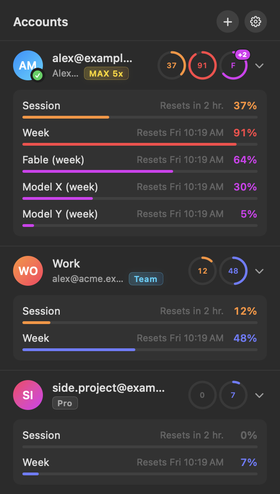
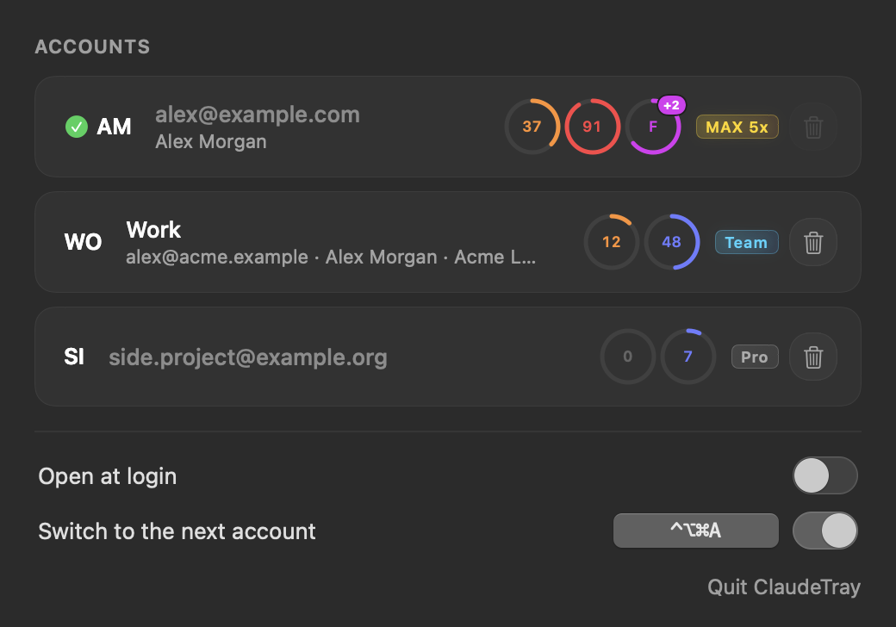

<div align="center">

# ClaudeTray

**Switch Claude Code accounts from the macOS menu bar or the Windows / Linux system tray.**

Log in to each account once, then switch with one click — no more `/logout` and `/login`.




</div>

## Features

- **One-click switching** between any number of Claude Code accounts.
- **Usage at a glance.** The tray icon shows two rings for the active account, like Activity rings: weekly limit outside, session inside, an orange spark in the middle. Rings turn red at 90%; exact numbers are in the tooltip.
- **Every limit of every account** with its plan (Max 5x, Team, Pro…): session, week, per-model limits and reset times. Limits are built from whatever the server returns, so new models and limit types show up on their own.
- **Adding an account** opens a terminal with `claude auth login`; the new account appears in the list automatically.
- **MCP logins survive switching.** Logins for MCP servers (Figma, Runpod, …) are shared across accounts.
- **Global hotkey** switches to the next account and shows a notification.
- **`claudetray` CLI** for scripts and the terminal.
- **Native and lightweight**: no browser, no webview.
- **13 languages**, picked from the system: English, Русский, Українська, Deutsch, Français, Español, Italiano, Português (Brasil), Polski, Türkçe, 日本語, 한국어, 简体中文.

<p align="center">
  
</p>

## Installation

### macOS

Requires macOS 14.4+ and the Command Line Tools (`xcode-select --install`).

```bash
cd mac
./build.sh            # builds build/ClaudeTray.app
./build.sh --install  # copies it to /Applications, launches it and installs ~/.local/bin/claudetray
```

### Windows and Linux

Prebuilt Windows and Linux x86_64 binaries are produced by [GitHub Actions](.github/workflows/desktop.yml) — grab them from the latest workflow run.

To cross-build from a Mac or any machine with Docker:

```bash
cd desktop
./build.sh check   # rustfmt, clippy for Linux and Windows, tests
./build.sh all     # dist/claudetray-windows-x86_64.exe and dist/claudetray-linux-<arch>
```

Or natively with `cargo build --release`. On Linux this needs `libgtk-3-dev libxdo-dev libayatana-appindicator3-dev libdbus-1-dev`.

Linux needs a tray with AppIndicator support: KDE, Cinnamon and XFCE have it, GNOME needs the AppIndicator extension. The global hotkey works on X11 only.

## Usage

### macOS

| Action | How |
|---|---|
| Switch account | click its card or ⌘1–⌘9 |
| All limits of an account | the chevron next to the account |
| Add account | **+** in the header or ⌘N |
| Settings | gear in the header or ⌘, |
| Remove, rename, recolor an account | in Settings: trash button, name field, click the avatar |
| Next account from any app | ⌃⌥⌘A (configurable in Settings) |
| Quit | ⌘Q, “Quit ClaudeTray” in Settings, or right-click the icon |

### Windows and Linux

Run `claudetray` with no arguments to start the tray icon. The menu has accounts with their limits, add / remove account, open at login, hotkey and quit.

The default hotkey is <kbd>Ctrl</kbd>+<kbd>Alt</kbd>+<kbd>Shift</kbd>+<kbd>A</kbd>. Change it in `settings.json` in the settings folder (`%APPDATA%\ClaudeTray` or `~/.config/ClaudeTray`), e.g. `"hotkey": "ctrl+alt+KeyS"`.

### Command line

```bash
claudetray list              # accounts and limits (on macOS plain `claudetray` works too)
claudetray switch 2          # by number
claudetray switch work       # by name or email, a prefix is enough
claudetray next              # next account, round-robin
claudetray rename 1 Work     # custom name (Windows and Linux; on macOS use Settings)
```

If the query matches several accounts, nothing is switched and the matches are listed.

## How it works

Claude Code keeps its login in two places:

| What | macOS | Windows and Linux |
|---|---|---|
| Tokens (`claudeAiOauth`) | Keychain, `Claude Code-credentials` | `~/.claude/.credentials.json` |
| Who is logged in (`oauthAccount`) | `~/.claude.json` | `~/.claude.json` |

ClaudeTray remembers the current login and stores each account's tokens in the system credential store — Keychain on macOS, Credential Manager on Windows, Secret Service on Linux. Account descriptions live in `accounts.json` in the app's settings folder. On switch, the saved login is put back. Only `claudeAiOauth` and `oauthAccount` are changed; nothing else is touched.

Before saving a new token, the app asks Anthropic who owns it (`GET /api/oauth/profile`). If the token belongs to a different account than the one in `~/.claude.json`, a warning with a **Restore** button appears.

Limits come from the same place as `/usage` in Claude Code (`GET /api/oauth/usage`), at most once every 3 minutes, with a 10-minute pause after a 429. The last responses are cached in `usage.json`. Tokens of inactive accounts are refreshed the same way Claude Code does it; the active account's token is refreshed only by Claude Code itself.

On macOS the Keychain is accessed through `/usr/bin/security`, just like Claude Code does, so there are no access prompts and rebuilding doesn't break anything.

## Limitations

- Already running Claude Code sessions stay on the old account. To continue a conversation under the new one, exit the session (`/exit`) and run `claude --continue` in the same folder.
- An old session may refresh its token on top of the new account. ClaudeTray will notice, but it's easier to close sessions before switching.
- If a saved login stops working, remove the account and add it again.
- Profiles using `CLAUDE_CONFIG_DIR` are not affected on macOS.

## Project structure

| Folder | What |
|---|---|
| [`mac/`](mac) | macOS 14.4+, Swift: AppKit + SwiftUI |
| [`desktop/`](desktop) | Windows and Linux, Rust: `tray-icon`, `tao`, `global-hotkey`, `keyring` |
| [`locales/`](locales) | Translations, `<lang>.lproj/Localizable.strings`, shared by both apps |

## Development

`ClaudeTray --snapshot file.png [--demo] [--settings]` renders the menu or the settings window to an image; `--demo` uses made-up accounts and limits (that's how the screenshots above are made). `-AppleLanguages '(de)'` changes the language.

```bash
cd mac && ./build.sh
A=build/ClaudeTray.app/Contents/MacOS/ClaudeTray
$A --snapshot ../docs/popover.png --demo -AppleLanguages '(en)' -AppleLocale en_US
$A --snapshot ../docs/settings.png --demo --settings -AppleLanguages '(en)' -AppleLocale en_US
```

## Translations

Keys are the English strings from the code; `%@` is a substituted value. With two substitutions, a translation can reorder them using `%1$@` and `%2$@`. To add a language, copy `locales/en.lproj` to `locales/<code>.lproj`, translate the values and register the language in `desktop/src/i18n.rs`.
