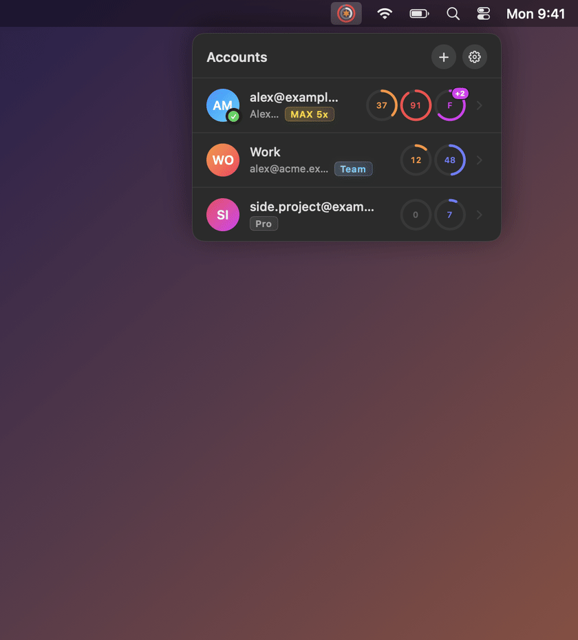

<div align="center">

# ClaudeTray

**Switch Claude Code accounts from the macOS menu bar or the Windows / Linux system tray.**

Log in to each account once, then switch with one click — no more `/logout` and `/login`.

<sub>Unofficial tool, not affiliated with Anthropic. See [Disclaimer](#disclaimer).</sub>




</div>

## Features

- **One-click switching** between any number of Claude Code accounts.
- **Usage at a glance.** The tray icon shows two rings for the active account, like Activity rings: weekly limit outside, session inside, an orange spark in the middle. Rings turn red at 90%; exact numbers are in the tooltip.
- **Every limit of every account** with its plan (Max 5x, Team, Pro…): session, week, per-model limits and reset times. Limits are built from whatever the server returns, so new models and limit types show up on their own.
- **Adding an account** opens a terminal with `claude auth login`; the new account appears in the list automatically.
- **MCP logins survive switching.** Logins for MCP servers (Figma, Runpod, …) are shared across accounts.
- **Global hotkey** switches to the next account and shows a notification.
- **`claudetray` CLI** for scripts and the terminal.
- **Native and lightweight**: no browser, no webview.
- **13 languages**, picked from the system: English, Русский, Українська, Deutsch, Français, Español, Italiano, Português (Brasil), Polski, Türkçe, 日本語, 한국어, 简体中文.

<p align="center">
  
</p>

## Download

Grab the latest build from [Releases](../../releases/latest):

| Platform | File |
|---|---|
| macOS 14.4+ (Apple Silicon) | `ClaudeTray-macos.dmg` |
| Windows | `ClaudeTray-windows-setup.exe` (installer) or `claudetray-windows-x86_64.exe` (portable) |
| Linux | `claudetray-linux-x86_64`, `claudetray-linux-aarch64` |

The builds are not signed by Apple or Microsoft, so the system will warn on first launch:

- **macOS**: open the DMG, drag `ClaudeTray.app` to Applications, then right-click it → **Open**, or run `xattr -dr com.apple.quarantine /Applications/ClaudeTray.app`.
- **Windows**: in the SmartScreen dialog click **More info** → **Run anyway**. The installer needs no admin rights, puts ClaudeTray into the Start menu and can add `claudetray` to PATH and enable open at login. The portable exe works too — keep it in a permanent folder before turning on open at login.
- **Linux**: `chmod +x claudetray-linux-*` before running.

## Building from source

### macOS

Requires macOS 14.4+ and the Command Line Tools (`xcode-select --install`).

```bash
cd mac
./build.sh            # builds build/ClaudeTray.app
./build.sh --install  # copies it to /Applications, launches it and installs ~/.local/bin/claudetray
```

### Windows and Linux

To cross-build from a Mac or any machine with Docker:

```bash
cd desktop
./build.sh check   # rustfmt, clippy for Linux and Windows, tests
./build.sh all     # dist/claudetray-windows-x86_64.exe and dist/claudetray-linux-<arch>
```

Or natively with `cargo build --release`. On Linux this needs `libgtk-3-dev libxdo-dev libayatana-appindicator3-dev libdbus-1-dev`.

Linux needs a tray with AppIndicator support: KDE, Cinnamon and XFCE have it, GNOME needs the AppIndicator extension. The global hotkey works on X11 only.

## Usage

### macOS

| Action | How |
|---|---|
| Switch account | click its card or ⌘1–⌘9 |
| All limits of an account | the chevron next to the account |
| Add account | **+** in the header or ⌘N |
| Settings | gear in the header or ⌘, |
| Remove, rename, recolor an account | in Settings: trash button, name field, click the avatar |
| Next account from any app | ⌃⌥⌘A (configurable in Settings) |
| Quit | ⌘Q, “Quit ClaudeTray” in Settings, or right-click the icon |

### Windows and Linux

Run `claudetray` with no arguments to start the tray icon. The menu has accounts with their limits, add / remove account, open at login, hotkey and quit.

The default hotkey is <kbd>Ctrl</kbd>+<kbd>Alt</kbd>+<kbd>Shift</kbd>+<kbd>A</kbd>. Change it in `settings.json` in the settings folder (`%APPDATA%\ClaudeTray` or `~/.config/ClaudeTray`), e.g. `"hotkey": "ctrl+alt+KeyS"`.

### Command line

```bash
claudetray list              # accounts and limits (on macOS plain `claudetray` works too)
claudetray switch 2          # by number
claudetray switch work       # by name or email, a prefix is enough
claudetray next              # next account, round-robin
claudetray rename 1 Work     # custom name (Windows and Linux; on macOS use Settings)
```

If the query matches several accounts, nothing is switched and the matches are listed.

## How it works

Claude Code keeps its login in two places:

| What | macOS | Windows and Linux |
|---|---|---|
| Tokens (`claudeAiOauth`) | Keychain, `Claude Code-credentials` | `~/.claude/.credentials.json` |
| Who is logged in (`oauthAccount`) | `~/.claude.json` | `~/.claude.json` |

ClaudeTray remembers the current login and stores each account's tokens in the system credential store — Keychain on macOS, Credential Manager on Windows, Secret Service on Linux. Account descriptions live in `accounts.json` in the app's settings folder. On switch, the saved login is put back. Only `claudeAiOauth` and `oauthAccount` are changed; nothing else is touched.

Before saving a new token, the app asks Anthropic who owns it (`GET /api/oauth/profile`). If the token belongs to a different account than the one in `~/.claude.json`, a warning with a **Restore** button appears.

Limits come from the same place as `/usage` in Claude Code (`GET /api/oauth/usage`), at most once every 3 minutes, with a 10-minute pause after a 429. The last responses are cached in `usage.json`. ClaudeTray never refreshes tokens itself: only Claude Code does, after you switch to an account. Once a saved token of an inactive account expires, its limits show the last known values until you switch to it.

On macOS the Keychain is accessed through `/usr/bin/security`, just like Claude Code does, so there are no access prompts and rebuilding doesn't break anything.

## Disclaimer

ClaudeTray is an unofficial, community-made tool. It is not affiliated with, endorsed by or supported by Anthropic. "Claude" and "Claude Code" are trademarks of Anthropic.

ClaudeTray is built to keep the official Claude Code as the only thing that talks to Claude on your behalf:

- **It does:** keep each account's Claude Code login in your system credential store, put the chosen login back where Claude Code expects it, and read usage limits (`/api/oauth/usage`, the same data as `/usage` in Claude Code).
- **It doesn't:** send requests to Claude models, refresh tokens or pretend to be Claude Code, proxy or share accounts, or send tokens anywhere outside your machine. Signing in always goes through the official `claude auth login`.

Anthropic hasn't said whether a local account switcher like this is allowed. Its [legal and compliance page](https://code.claude.com/docs/en/legal-and-compliance) says that subscription OAuth is intended for ordinary use of Claude Code and that developers may not "collect, store, or intermediate Claude.ai credentials or session tokens", which could be read to cover storing your own logins locally. The usage endpoint is undocumented and may change. Use ClaudeTray at your own risk.

## Limitations

- Already running Claude Code sessions stay on the old account. To continue a conversation under the new one, exit the session (`/exit`) and run `claude --continue` in the same folder.
- An old session may refresh its token on top of the new account. ClaudeTray will notice, but it's easier to close sessions before switching.
- If a saved login stops working, remove the account and add it again.
- Profiles using `CLAUDE_CONFIG_DIR` are not affected on macOS.

## Project structure

| Folder | What |
|---|---|
| [`mac/`](mac) | macOS 14.4+, Swift: AppKit + SwiftUI |
| [`desktop/`](desktop) | Windows and Linux, Rust: `tray-icon`, `tao`, `global-hotkey`, `keyring` |
| [`locales/`](locales) | Translations, `<lang>.lproj/Localizable.strings`, shared by both apps |

## Development

Pushing a `v*` tag (`git tag v1.0.0 && git push origin v1.0.0`) builds all platforms and publishes a release via [`release.yml`](.github/workflows/release.yml).

`ClaudeTray --snapshot file.png [--demo] [--expanded] [--menubar | --settings]` renders the menu (optionally under a mock menu bar) or the settings window to an image. `--demo` uses made-up accounts and limits, `-AppleLanguages '(de)'` changes the language.

The screenshots in this README are rendered by [`docs/screenshots.sh`](docs/screenshots.sh) (needs `ffmpeg`).

## Translations

Keys are the English strings from the code; `%@` is a substituted value. With two substitutions, a translation can reorder them using `%1$@` and `%2$@`. To add a language, copy `locales/en.lproj` to `locales/<code>.lproj`, translate the values and register the language in `desktop/src/i18n.rs`.
